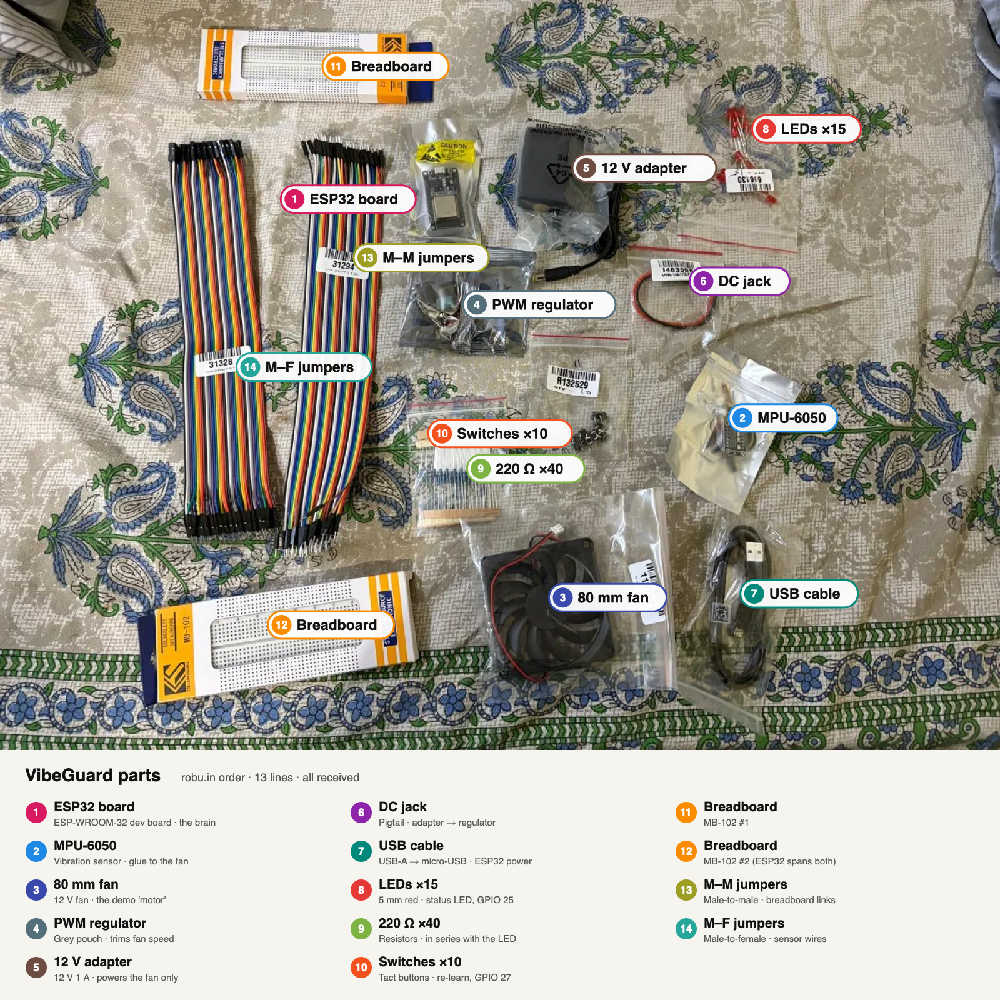

# Demo plan: showing fault detection on a new motor

A new motor is healthy, so the faults have to be **added on purpose**. This is called "seeded fault" testing, and it's how vibration-monitoring research is usually done. The order is always:

1. Run the motor healthy and let VibeGuard learn for 20 s. Hold the button 1.5 s to re-learn at any time.
2. Show **HEALTHY** on the dashboard.
3. Add one fault and show the matching WARNING or ALARM, the fault name and the advice.
4. Remove the fault and show it return to HEALTHY.

## Motor choice (important)

The firmware looks for the shaft speed between **8 and 80 Hz, which is 480–4,800 RPM** (`SHAFT_MIN_HZ`/`SHAFT_MAX_HZ` in `vg_config.h`). Many cheap DC motors spin much faster than that.

| Motor | Fits? | Notes |
|---|---|---|
| **12 V 80 mm PC fan (double ball bearing) + small PWM regulator** | ✅ **Chosen (5 Nov 2026)** | A brushless motor with ball bearings, about 2,000–3,500 RPM (exact RPM not listed, so the regulator is there to trim it). Blades take an imbalance weight, and its 4 screw holes make the looseness demo easy. It's safe and cheap. |
| 775 DC motor (12 V) + PWM speed controller | ✅ Works, costs ₹536 more | Has ball bearings. Use the controller to keep it at about 1,500–3,000 RPM; at full 12 V it runs about 10,000 RPM, which is out of range. |
| Old table or pedestal fan (AC) | ✅ Good backup | About 1,200–1,400 RPM, and the blade is ready for adding a weight. A used one also gives a real worn bearing. |
| 130 / R385 toy DC motor | ⚠️ Avoid | Sleeve bushings, not ball bearings, and too fast at rated voltage. |

## How to create each fault

| Fault | How to create it | Expected result | Reliability |
|---|---|---|---|
| **Imbalance** (1×) | Tape a small weight (a coin, an M3 nut or a lump of blu-tack) near the edge of **one** fan blade or the disc. Add more weight to show the health % fall further. | The imbalance ratio rises → IMBALANCE WARNING/ALARM | Very easy, the best demo |
| **Looseness** (2×–3×) | Mount the motor on a plate with 4 bolts, then loosen 2 of them, or put a rubber washer under one foot so it rocks. | LOOSENESS | Easy |
| **Bearing wear** (100–240 Hz) | Use a used motor or fan with a worn bearing, **or** a spare 608 bearing on the shaft that has been degreased and has a pinch of fine sand added. | BEARING | The hardest to fake. Have a backup. |
| **Motor off** | Switch it off. | MOTOR OFF, not a false fault | Trivial |

**Backup if the bearing demo fails:** flash the simulation build (`VG_SIM 1`, see [SIMULATION.md](SIMULATION.md)). Its dashboard buttons switch between all the fault scenarios. Say clearly that this mode is simulated.

## Demo tips

- Glue or clamp the sensor to the motor body. Never tape it.
- Bolt the motor rig to a heavy base, so the "healthy" baseline is quiet.
- Keep the fan blade or disc guarded. Weights fly off at speed, so use tape plus glue and wear safety glasses.
- Re-learn the baseline after moving the rig or changing the speed.

## Full shopping list

Prices are **estimates** (typical Indian retail). Replace them with real receipts.

### VibeGuard device

| Item | Qty | Est. ₹ |
|---|---|---|
| ESP32 DevKit V1 (WROOM-32) | 1 | 400 |
| MPU6050 GY-521 module | 1 | 150 |
| LED (any colour) + 220 Ω resistor | 1 | 5 |
| Push button (tactile, 6 mm) | 1 | 10 |
| Breadboard + male-to-female jumper wires | 1 set | 150 |
| Micro-USB data cable (for flashing + power) | 1 | 100 |
| 3D-printed enclosure (about 25 g PLA) + strap/clamp | 1 | 200 |
| Hot glue or epoxy (sensor mounting) | 1 | 50 |

### Demo motor rig

| Item | Qty | Est. ₹ |
|---|---|---|
| 775 DC motor, 12 V, ball bearing | 1 | 300 |
| PWM DC motor speed controller (12 V, 5 A+) | 1 | 150 |
| 12 V 5 A power adapter (DC jack) | 1 | 350 |
| Fan blade or aluminium disc / coupling for the 5 mm shaft | 1 | 100 |
| 775 motor mounting bracket | 1 | 80 |
| Wooden or MDF base plate + M4 bolts, nuts, rubber washers | 1 set | 100 |
| Fault kit: coins/M3 nuts, blu-tack, tape, a spare 608 bearing, fine sand | 1 set | 80 |
| Old table fan with a worn bearing (optional, second-hand) | 1 | 0–300 |

Device alone ≈ ₹1,065, rig ≈ ₹1,260 (excluding the optional fan). The original ₹1,140 figure covers the device plus a small test motor only.

## Robu.in order (ordered 6 Nov 2026, sale order 3799481, all 13 lines received)

Invoice total ₹2,104.05 = parts ₹1,836.45 + Bluedart Air shipping ₹168.60 + COD charges ₹99 (all incl. GST). A labelled photo of the received parts is in [images/parts_labeled.png](images/parts_labeled.png).

### Cart as planned (5 Nov 2026)

Added to a robu.in guest cart in the built-in browser. All items were in stock at the time. Prices include GST. Total **₹1,836.45** (after swapping the 775 motor rig for a fan rig, which saved ₹536), so delivery is still free (over ₹999).

| Item on robu.in | Qty | ₹ | Notes |
|---|---|---|---|
| ESP-WROOM-32 WiFi Bluetooth Development Board (SKU 835800) | 1 | 434 | Classic 30-pin DevKit V1, micro-USB |
| SmartElex MPU-6050 3-Axis Accelerometer and Gyro Module (R268095) | 1 | 444 | The plain GY-521 was not listed in stock. This board has the same chip, with AD0 for address 0x68 |
| DC12V 8010 double ball-bearing cooling fan, 80 mm (1187521) | 1 | 239 | The demo "motor" |
| 6–35 V 5 A mini PWM motor speed regulator (699612) | 1 | 79 | Trims the fan speed if it runs above 4,800 RPM |
| Standard 12V 1A Power Supply, 5.5 mm DC plug | 1 | 209 | A fan draws only about 0.1 A |
| SafeConnect DC Jack Female 2.1×5.5 mm pigtail (1463568) | 1 | 46 | Adapter plug → regulator screw terminals |
| 5mm Red DIP LED | 15 | 11.85 | Robu's ₹10 minimum per line |
| 220 Ω 0.25 W metal film resistor | 40 | 13.60 | Same reason |
| KFC-A06 6×6×5 tact switch, 4-pin | 10 | 13.00 | Same reason |
| MB102 830-point breadboard | 2 | 138 | The ESP32 is too wide for one breadboard; use two side by side |
| Male-to-female jumper wires 40 pin 30 cm | 1 | 71 | Sensor on the motor → breadboard |
| Male-to-male jumper wires 40 pin 30 cm | 1 | 79 | |
| USB-A to Micro-USB cable 100 cm (data) | 1 | 59 | A USB-C Mac needs a USB-C→A adapter |

**Fan rig wiring:** 12 V adapter → DC jack pigtail → PWM regulator input; regulator output → fan red/black. The ESP32 stays on USB, separate from the fan supply. Screw the fan to the base with 4 M3/M4 screws, then loosen 2 of them for the looseness demo.

**Not bought on robu (get locally or make):** the MDF/wood base and screws, hot glue/epoxy, the fault kit (coins, nuts, blu-tack), and optionally an old table fan for the bearing demo.
