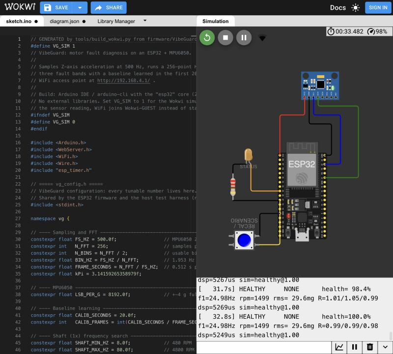
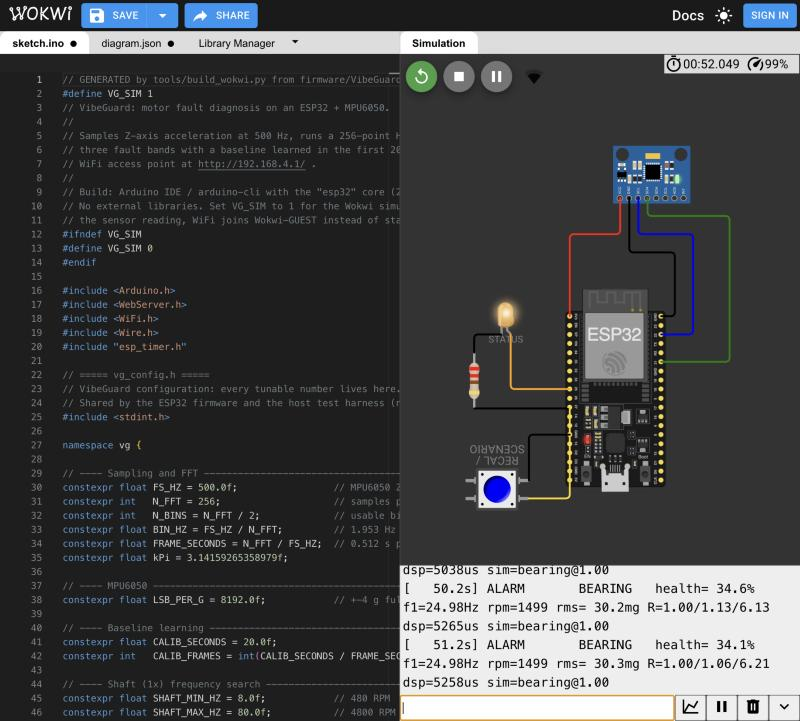

# Simulation and testing guide

There are three ways to exercise VibeGuard without a motor. Use them in this order.

| Level | What runs | Tool | Time |
|---|---|---|---|
| 1. Host tests | The real DSP + diagnosis code with synthetic motor signals, 15 automated checks | `tests/run_tests.sh` (clang++) | 3 s |
| 2. Wokwi | The whole firmware on a simulated ESP32 + MPU6050 + LED + button | wokwi.com (browser) | About 2 min (runs at real time while its tab is visible; a hidden or background tab throttles it to about 3%) |
| 3. Dashboard mock | The real dashboard page fed with engine output | `tools/dashboard_mock.py` | instant |

## 1. Host tests

```bash
./tests/run_tests.sh
```

This compiles `tests/test_vibeguard.cpp` against `firmware/VibeGuard/*.h` and writes:

- `tests/results/summary.md`: every measurement table (copied into [TEST_REPORT.md](TEST_REPORT.md))
- `tests/results/shaft_estimate.csv`, `severity_sweep.csv`: raw data
- `tests/results/timeline.jsonl`: a 3.5-minute scripted run (calibrate, then imbalance, looseness, bearing, motor off), used by the dashboard mock

The exit code is non-zero if any check fails.

## 2. Wokwi (full firmware)

Wokwi's MPU6050 only reports a constant acceleration set with sliders, so it can't vibrate. The firmware therefore has a **simulation build** (`VG_SIM 1`), which:

- adds a synthetic motor signal (`vg_sim.h`) to the real I2C reading, so the whole path still runs: timer, I2C, buffer, FFT, diagnosis
- joins `Wokwi-GUEST` instead of starting a soft-AP, because Wokwi has no AP mode
- adds the scenario controls below

### Run it in the browser

1. `python3 tools/build_wokwi.py`. This writes `wokwi/sketch.ino`, a single file with `VG_SIM 1`.
2. Open https://wokwi.com/projects/new/esp32.
3. Replace `sketch.ino` with `wokwi/sketch.ino` and `diagram.json` with `wokwi/diagram.json`.
4. Press ▶. The first compile waits in Wokwi's free build queue (about 30 s).
5. Watch the serial monitor. A status line prints every second:
   ```
   [   25.1s] HEALTHY     NONE      health= 98.7% f1=25.00Hz rpm=1500 rms= 29.1mg R=1.01/0.98/1.02 dsp=3260us
   ```
   R is the energy ratio per band: imbalance / looseness / bearing.

### Screenshots (5 Nov 2026)

Circuit loaded from `wokwi/diagram.json` and firmware from `wokwi/sketch.ino`.

| Healthy motor | Bearing fault injected (serial `b`) |
|---|---|
|  |  |

### Controls

| Input | Action |
|---|---|
| Serial `h` `i` `l` `b` `o` | Scenario: healthy, imbalance, looseness, bearing, motor off |
| Serial `0`–`9` | Severity 0.0 to 1.8 in steps of 0.2 (1.0 = nominal fault) |
| Serial `r` | Re-learn the baseline |
| Serial `j` | Print the full status JSON |
| Button, short press | Next scenario |
| Button, hold 1.5 s | Re-learn the baseline |
| LED | 2 Hz = learning, short blip every 3 s = healthy, 1 Hz = warning, 5 Hz = alarm, off = motor off |

### Dashboard from Wokwi

The web server runs in the simulation too. Reaching it needs Wokwi's network forwarding, which the **VS Code extension** provides: `wokwi/wokwi.toml` forwards `localhost:8180` to port 80 of the simulated board. The browser version can't forward ports, so use the mock (level 3) to see the page.

VS Code route: install arduino-cli and the esp32 core, then build into `wokwi/build` with `-DVG_SIM=1` (the command is in `wokwi.toml`). Install the Wokwi extension, open `wokwi/diagram.json` and start the simulator.

## 3. Dashboard mock

```bash
./tests/run_tests.sh
python3 tools/dashboard_mock.py
```

Open http://127.0.0.1:8180/. The page is extracted from `vg_dashboard.h`, so it's byte-for-byte what the ESP32 serves. The data is the engine's own JSON from the host run, replayed at the device's pace (one frame per 0.512 s). The simulation buttons jump to each scenario, and *Re-learn* restarts the replay.

## Real hardware

1. In the Arduino IDE, install the "esp32" board package (Espressif) and pick **ESP32 Dev Module**.
2. Open `firmware/VibeGuard/VibeGuard.ino`. `VG_SIM` defaults to 0.
3. Upload, then open the serial monitor at 115200 baud.
4. Start the motor, then reset the board and let it learn for 20 s.
5. Join WiFi **VibeGuard** (password `vibeguard`) and open http://192.168.4.1/.
